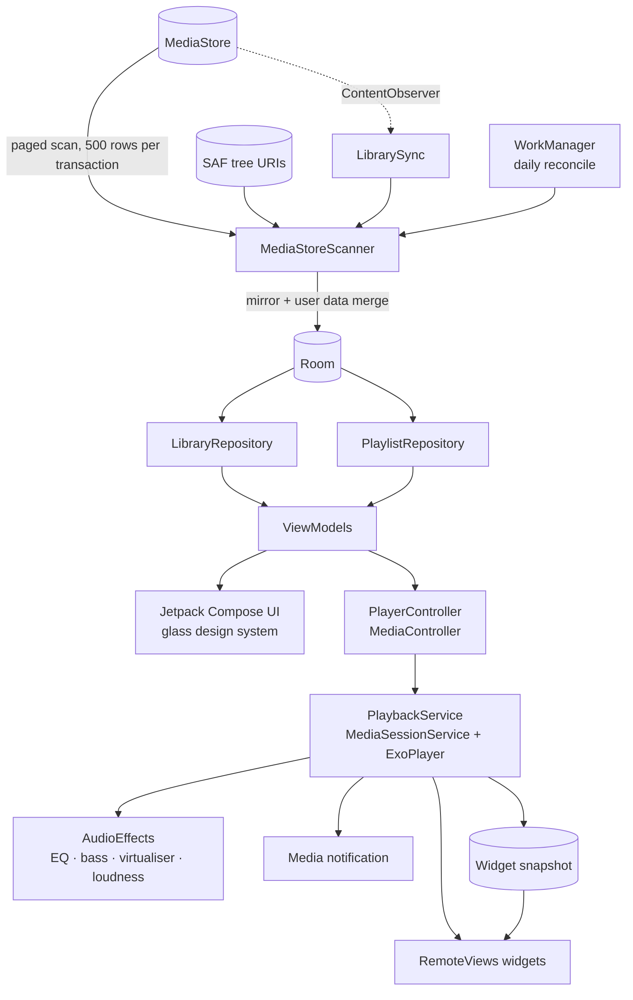

# Aura Player

**A free, offline music player for Android — liquid-glass UI, no ads, no account, no telemetry.**

Aura plays the audio files that are already on your phone. It reads your library from MediaStore,
mirrors it into Room so ratings and play counts survive rescans, and plays through Media3 ExoPlayer
behind a `MediaSessionService` — which is what gives you the lock-screen notification, headset
buttons, AVRCP metadata and the Android 13+ media output picker for free.


---

## Download

Prebuilt debug APKs live on the [Releases](https://github.com/sachintha82288-cpu/Aura-Player/releases) page.

| File | Size | Notes |
|---|---|---|
| `aura-player-debug.apk` | 16,860,359 bytes | debug-signed, installs on Android 8.0+ |
| `aura-player-source.zip` | 107,552 bytes | the full Kotlin source tree |

```text
SHA-256  b7522aee4cf96f121516f047eaecd7c79601702d2bbc711638ee4f223728d8b2  aura-player-debug.apk
```

### Install

1. Download the APK to the phone.
2. Allow **Install unknown apps** for your browser or file manager when prompted.
3. Open the app, grant **audio access**, and let the first scan finish.
4. Tap a track. The first play starts the playback service and the media notification.

> The APK is signed with a debug keystore, so it cannot be published to Play Store as-is and will not
> update over a release-signed build. See [Build from source](#build-from-source) for a proper key.

---

## What it does

### Library

| Feature | Status |
|---|---|
| Songs, albums, artists, folders, playlists tabs | ✅ |
| Sort by title, artist, album, date added, duration, play count, path (and reverse) | ✅ |
| Auto lists: recently added, recently played, most played, favourites, top rated | ✅ |
| Fuzzy search across title, artist, album, album artist, folder and filename | ✅ |
| Multi-select: play next, add to queue, favourite, rate, add to playlist | ✅ |
| Hide folders, per-folder play and shuffle | ✅ |
| Ignore tracks shorter than 30 s (ringtones, notification sounds) | ✅ |
| Genres / years / album-artist browsing | 🟡 data layer only, no UI yet |
| Nested, expandable folder tree | 🟡 flat folder list today |
| "Unknown artist/album" bucket with one-tap fix | ❌ |

### Playback

| Feature | Status |
|---|---|
| `MediaSessionService` + ExoPlayer, gapless-capable pipeline | ✅ |
| Queue: reorder, remove, jump, save queue as playlist | ✅ |
| Sleep timer: fixed minutes, end of track, end of album | ✅ |
| Speed 0.5×–3.0× with pitch preservation | ✅ |
| Resume position for tracks longer than 15 minutes | ✅ |
| Audio focus, ducking, becoming-noisy, call interruption | ✅ |
| Shuffle, repeat off / all / one | ✅ |
| Crossfade, ReplayGain / EBU R128 normalisation | ❌ |
| Resume on headset or Bluetooth connect | ❌ setting stored, receiver not wired |

### Audio

| Feature | Status |
|---|---|
| 10-band equaliser with the device's own presets and editable bands | ✅ |
| Bass boost, virtualiser, loudness enhancer | ✅ |
| MP3, AAC/M4A, FLAC, ALAC, WAV, OGG, Opus | ✅ ExoPlayer extractors |
| Balance and mono toggle | ❌ |

### Lyrics, tags, playlists

| Feature | Status |
|---|---|
| Sidecar `.lrc` with synced line highlighting, full-screen view | ✅ |
| No online lyric fetching, ever | ✅ by design |
| Single-track tag editor through MediaStore | 🟡 Android only lets an app rewrite tags on files it owns |
| Batch tag editing, tag-from-filename, artwork replace | ❌ |
| Manual playlists, M3U export and import | ✅ |
| Smart playlists: field / operator / value rules with AND–OR | ✅ |
| Drag reorder in playlists and queue | 🟡 up/down buttons |
| 0–5 star ratings and a Top-rated list | ✅ |

### System

| Feature | Status |
|---|---|
| Rich media notification, media output picker, AVRCP, headset buttons | ✅ via MediaSessionService |
| Five widgets: 2×1, 4×1, 2×2, 4×2, 4×4 | ✅ |
| Per-widget tint, corner radius and glass opacity | ✅ via the widget config screen |
| Blurred artwork, progress with elapsed/total, next-up peek | ✅ |
| Backup and restore of settings, ratings and playlists to JSON | ✅ |
| Themes: glass dark, glass light, AMOLED, artwork accent | ✅ |
| Set as ringtone / notification / alarm | ❌ |

---

## Screens

`Library` · `Search` · `Now playing` · `Queue sheet` · `Lyrics` · `Equalizer` · `Sleep timer`
· `Playlist detail` · `Smart playlist rules` · `Tag editor` · `Settings` · `Widget config`

Screenshots are not committed yet — the build in this repository has not been through a device pass.
Once it has, they belong in `docs/screenshots/`.

---

## Architecture



**Source of truth is MediaStore.** Room is a mirror plus everything MediaStore cannot store: ratings,
play counts, last-played timestamps, favourites, resume positions, playlists and hidden folders. A scan
merges those fields back onto fresh MediaStore rows, so a rescan never wipes your data.

**Playback lives in a service.** The UI never touches ExoPlayer directly; it talks to a
`MediaController` bound to `PlaybackService`, which is what keeps audio alive with the screen off and
lets the notification, widgets and Bluetooth controls drive the same session.

**Widgets never poll.** The service writes a snapshot (title, artist, position, artwork path, next-up)
whenever playback state changes; widget providers render from that snapshot. No timers, no wakeups.

---

## The liquid-glass design system

Four cheap layers, no live backdrop blur on scrolling content:

| Layer | Implementation |
|---|---|
| **Backdrop** | current artwork downscaled to 96 px, three-pass box blur, cached; regenerated only on track change (`ui/glass/Glass.kt`) |
| **Scrim** | vertical gradient from transparent to 45 % at the edges, theme-aware |
| **Surface** | panel fill at 7–14 % (dark) or 66 % (light) with a 1 dp border and a top highlight |
| **Texture** | 128 px grain tile drawn through a repeating shader at 2–3 % to stop OLED banding |

Tokens (`ui/theme/Theme.kt`): panel radius 28 dp, control radius 18 dp, pill 999 dp, motion 280 ms for
sheets / 340 ms for the container morph / 200 ms fades, two font weights, 4 dp spacing grid.
A **Reduced transparency** setting swaps the blurred backdrop for flat gradients.

Motion lives in one file (`ui/glass/Motion.kt`) so nothing in the app moves on a different curve:
list item placement, tab and detail transitions, selection bars, artwork and title crossfades on track
change, mini-player progress, press-scale feedback on every button.

---

## Project structure

```text
app/src/main/java/com/sachintha/auraplayer/
├── data/
│   ├── db/                     Room entities, DAOs, database
│   ├── MediaStoreScanner.kt    paged MediaStore + SAF scanning
│   ├── LibrarySync.kt          ContentObserver + daily reconcile worker
│   ├── LibraryRepository.kt    flows, sorting, fuzzy search, auto lists
│   ├── PlaylistRepository.kt   manual + smart playlists, M3U
│   ├── LyricsRepository.kt     .lrc parsing
│   ├── TagEditor.kt            MediaStore tag writes
│   ├── BackupManager.kt        JSON backup / restore
│   └── SettingsRepository.kt   DataStore preferences
├── playback/
│   ├── PlaybackService.kt      MediaSessionService, sleep timer, effects host
│   ├── PlayerController.kt     MediaController wrapper exposing StateFlow
│   ├── AudioEffects.kt         equaliser, bass boost, virtualiser, loudness
│   └── EqBridge.kt             live equaliser state for the UI
├── ui/
│   ├── glass/                  design system: background, panels, motion
│   ├── theme/                  tokens and colour schemes
│   ├── library/ search/ nowplaying/ playlist/ settings/ tags/
│   └── AuraRoot.kt             navigation shell, mini player, insets
├── widget/                     providers, renderer, per-widget style, config activity
├── vm/                         Hilt view models
└── di/                         Hilt modules
```

45 Kotlin files · ~7,300 lines · 0 TODO/FIXME/placeholder markers in `app/src/main`.

---

## Build from source

**Requirements:** JDK 17, Android SDK with platform 35 and build-tools 35.0.0, Gradle 8.9
(or use the wrapper).

```bash
git clone https://github.com/sachintha82288-cpu/Aura-Player.git
cd Aura-Player

# point Gradle at your SDK
echo "sdk.dir=$ANDROID_HOME" > local.properties

./gradlew assembleDebug
# → app/build/outputs/apk/debug/app-debug.apk

./gradlew assembleRelease   # needs your own signing config
```

Stack: Kotlin 2.0.21 · AGP 8.7.3 · Gradle 8.9 · Compose BOM 2024.10.01 · Material 3 · Media3 1.4.1 ·
Room 2.6.1 · Hilt 2.52 · DataStore · Coil · WorkManager · kotlinx.serialization.

`minSdk 26`, `compileSdk`/`targetSdk 35`. Permissions: `READ_MEDIA_AUDIO` (13+),
`READ_EXTERNAL_STORAGE` (≤ 32), `FOREGROUND_SERVICE_MEDIA_PLAYBACK`, `POST_NOTIFICATIONS`,
`WAKE_LOCK`. Aura **never** requests `MANAGE_EXTERNAL_STORAGE`; folders MediaStore does not index are
reached through Storage Access Framework tree URIs.

---

## Verification status

Be clear about what has and has not been proven:

| Claim | Evidence |
|---|---|
| Compiles and packages | `./gradlew assembleDebug` → `BUILD SUCCESSFUL`, APK 16,860,359 bytes |
| Correct manifest and SDK levels | `aapt dump badging` → `com.sachintha.auraplayer`, versionCode 1, minSdk 26, targetSdk 35 |
| No stubs or dead ends | `grep -rn "TODO\|FIXME\|NotImplemented\|Coming soon" app/src/main --include=*.kt` → 0 |
| Launches without crashing | **not verified** — no device or emulator was available in the build environment |
| Real audio plays end to end | **not verified** — same reason |
| Library lists real files at runtime | **not verified** — same reason |

Treat the first three as facts and the last three as claims awaiting a device pass. If you install it,
the useful order is: permission → scan → play → lock screen → notification → one widget of each size →
rotate the device.

---

## Known limitations

* **Tag editing is constrained by Android.** On modern Android only the app that created a file may
  rewrite its tags through MediaStore; Aura surfaces the system refusal instead of pretending to save.
* **Crossfade, ReplayGain, balance/mono, batch tagging, artwork replacement, ringtone setter, PLS/M3U8
  and headset-connect resume are not implemented.** They are listed rather than hidden.
* **Widget seek bars are display-only.** RemoteViews cannot host a draggable seek bar; the 4×2 and 4×4
  widgets show progress plus elapsed/total time.
* **The mini player → now playing transition is a spring scale/slide**, not a shared-element container
  transform.
* **Debug signing only.** Generate your own keystore before distributing.

## Roadmap

1. Device pass: crash log, playback, notification, widgets, rotation.
2. Wire headset/Bluetooth resume and remove the setting until it works.
3. Dual-player crossfade; ReplayGain analysis during the scan.
4. Batch tag editing with a real tag-writing library.
5. Drag reorder for queue and playlists; expandable folder tree.
6. Shared-element morph, then screenshots and a signed release.

## Contributing

Issues and pull requests are welcome. Please keep the house rules: no stubs, no hardcoded sample data,
no feature hidden behind a flag to make a build pass, and every claim in a PR backed by a command you
actually ran.

## License

No license has been chosen yet, so all rights are reserved by default. If you intend to distribute or
accept contributions, add a `LICENSE` file — MIT or Apache-2.0 both fit this project.

---

<sub>Built with Kotlin, Jetpack Compose and Media3. No ads, no account, no subscription, no telemetry —
the app has no networking code at all.</sub>
